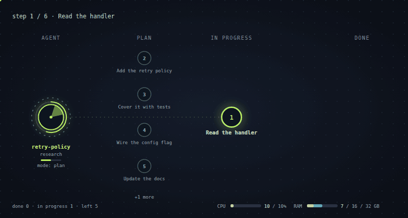

# agent-stage-cc

A live, animated stage for agent work in Claude Code. It sits beside the chat
and shows what your agents are doing: one agent working through its plan, or a
whole team in the git worktrees of your repository, with who is waiting on
you, who holds a shared resource such as a local stack of containers, and what
it all costs your machine.


It is a Claude Code mod (a plugin of function hooks). It reads what agents do
and never asks them to report anything, it enforces nothing, and it needs no
configuration to start.

## Three ways to work

Start a session, say how you want to work, then say what you want done:

| Command | How the agent works | What the pane shows |
| --- | --- | --- |
| `/stage agent plan` | Plan first: context, requirements, a proposal, and only after you accept it, the work and a check | The agent's plan, with a gate where it waits for you |
| `/stage agent full` | The whole task in one run, in stages, without stopping for approval | The agent's plan, moving on its own |
| `/stage agent coordinate` | Takes your tasks in, hands them out to agents in their own worktrees, watches over them and keeps the shared resource in order | The team |



These three are built in. A mode is a Markdown file of rules, so you can
replace any of them or write your own, for yourself or for a project. See
[Working modes](#working-modes).

A mode is optional. Without one the stage still shows everything it can read:
`/stage` opens the pane.

## What you see

- **A pane beside the chat** with one of two scenes. *The team*: a
  coordinator, the agents at work, a queue, the shared resource and open pull
  requests. *A plan*: one agent and the steps of its task list, moving from
  waiting, through in progress, to done. The layout follows the pane's shape.
- **A row above the prompt** with bare figures in fixed colors: CPU and
  memory, each as the stage's own share and then the whole machine, what is
  left of your Claude rate limits, open questions and failed tests. Hover a
  figure for its name.
- **The same figures in the status line**, with short names.
- **Notifications** when an agent asks you something, its tests fail, or the
  shared resource is released.

## Install

At the prompt of a terminal session:

```
/plugin install agent-stage-cc --marketplace Davv7d/agent-stage-cc
```

From a shell:

```bash
claude plugin install agent-stage-cc --marketplace Davv7d/agent-stage-cc
```

In the desktop app, where `/plugin` does not run: click **+** next to the
prompt box, then **Plugins**, **Add marketplace** with
`Davv7d/agent-stage-cc`, then **Add plugin**.

Sessions that were already running pick the mod up when they are restarted.

## Try it

```
/stage demo
```

opens the pane with an invented team that walks through every state, and

```
/stage demo plan
```

shows one invented agent working through a plan. `/stage live` returns to
real data.

## Working modes

A working mode is a way of working, written down. Turn one on at the start of
a session and the agent knows how you work together before you say what you
want:

```
/stage agent plan
```

A mode says how the agent works; a view is what the pane draws (see
[Two scenes](#two-scenes)). Turning a mode on picks the view that suits it,
so one command is enough. `/stage agent` lists the modes on offer, and
`/stage agent off` ends the one that is on.

### The built-in modes

- **`plan`**: plan first, then work. The agent reads what the project says
  about itself (its agent instructions and the skills and documents that bear
  on the task), establishes the requirements, makes a proposal and stops. Only
  once you accept the proposal does the work begin, followed by a check.
- **`full`**: the whole task in one run. The same stages, without stopping for
  approval between them.
- **`coordinate`**: the session takes your tasks in, splits them, hands each
  piece to an agent in a worktree of its own, watches over them and brings
  their questions and results to you. It also keeps the record of the shared
  resource: who holds it, who waits, and in what order. Who goes first stays
  yours and the project's to decide.

`plan` and `full` tell the agent to keep the phases as its task list, so the
pane shows them as the plan: which phase is in progress, which are done, and
the gate where the agent waits for you. `coordinate` makes the session the
coordinator at once and shows the team.

### Your own modes

A mode is a Markdown file named `<mode>.md`:

- yours, in `~/.config/agent-stage-cc/modes/`
- a project's, in `.agent-stage-cc/modes/` of the repository

A project's mode takes precedence over yours of the same name, and yours over
a built-in one, so a `plan.md` of your own replaces the built-in `plan`. The
file's text is what the agent reads; its first heading is the mode's title.

A mode is watched on its agent's plan unless the file opens with settings
that say otherwise. The settings are for the stage and are not shown to the
agent:

```markdown
---
view: team
role: coordinator
---
# Lead the release

Hand the work out, ...
```

### What a mode is and is not

The mod hands the rules to the agent and draws what the agent then does. It
checks nothing and enforces nothing: a mode is an instruction, as `CLAUDE.md`
is, and how closely it is followed is up to the model. A project's mode file
is read only when you turn that mode on. The rules reach the agent with your
next message, and they head every new thread of the session while the mode is
on.

## Two scenes

The pane shows one of two scenes, drawn from the same parts.

- **The team**: every agent in its zone. Agents keep a fixed place and glide
  between zones as their state changes. An agent that keeps a task list shows
  its progress, such as `3/7`, beside it.
- **A plan**: one agent on the left and its steps in three zones. The step in
  progress is joined to the agent by a line that sparks while the agent
  works, faster for tests than for reading. Finished steps move to the right.

The steps are the task list the agent already keeps: `TodoWrite`,
`TaskCreate` and `TaskUpdate`, or the list tool of the app it runs in. The mod
reads the calls and asks nothing more of the agent; an agent that keeps no
list has no plan to show.

Left on `auto`, the pane shows a plan when exactly one agent is in play (not
asleep, not merged) and keeps a list, and the team otherwise. The switch in
the pane, `/stage view`, or `"view"` in your config holds it to one scene.

There is no setting for working step by step or in one run: the scene shows
what happens. An agent that stops between steps leaves the finished step at a
gate, marked as waiting for you; an agent that runs on never shows the gate.

## How the stage reads an agent

Each session that has the mod records what its agent is doing in a small file
shared by every worktree of the repository, and every session draws the stage
from those files. One agent is one worktree; its name and its color follow
the worktree folder's name.

| State | When |
| --- | --- |
| `idle` | Nothing is running |
| `research` | Reading and searching: `Read`, `Grep`, `Glob`, web tools, read-only shell commands |
| `coding` | Editing files, or any other shell command |
| `testing` | A shell command that runs tests |
| `failed` | That command failed |
| `question` | The agent asked a question, or ended its turn on one |
| `queue` | The agent waits for the shared resource |
| `pr` | `gh pr create` answered with a pull request's address |
| `done` | The pull request merged; the agent then leaves the stage |

Pink always means a question for you, red an error, amber something worth a
look. A session becomes the **coordinator** the first time it hands work to
another session, or at once in a mode that says so.

The state names are a stable contract: skins and other tools may rely on them.

## A shared resource

Some things only one agent should use at a time: a local stack of containers,
a staging database, a device. The mod records who holds such a resource and
who waits, and draws it as a ring with the holder inside and the queue beside
it. It **only records and shows**: who gets the resource is your decision, or
your coordinator's, and nothing is blocked or restored for you.

The model has the same actions as a tool, `resource`, and every session is
told in a short section of its instructions how to keep the record with it: a
coordinator grants, queues and releases, and the holder reports its scope.
That section teaches the tool and sets no policy; `"guide": false` in your
config leaves it out.

Once the holder names the containers it will touch, the ring has one segment
per container. A swapped image shows in the holder's color (told by comparing
with the image each container ran when it came into scope), and a rim marks a
container under load.

Without a resource the scene simply has no ring.

## Commands

| Command | What it does |
| --- | --- |
| `/stage` | Open the pane |
| `/stage agent` | List the working modes and say which is on |
| `/stage agent <mode>`, `/stage agent off` | Turn a working mode on for this session, or off |
| `/stage view auto`, `team`, `plan` | Choose the scene; `auto` picks by who is at work |
| `/stage demo`, `/stage demo plan`, `/stage live` | An invented team, an invented plan, or real data |
| `/stage band` | Hide or show the row above the prompt |
| `/stage status` | The stage as text |
| `/stage grant <agent>` | Give the shared resource to an agent |
| `/stage release` | Free it |
| `/stage queue <agent>`, `/stage unqueue <agent>` | Add to or remove from the waiting line |
| `/stage order <agent> <agent> ...` | Put the waiting line in this order |
| `/stage scope <container> ...` | Say which containers are in scope |

`<agent>` is a worktree name or a distinctive part of one.

## Configuration

Everything is optional.

**Yours**, in `~/.config/agent-stage-cc/config.json`:

```json
{
  "band": true,
  "guide": true,
  "view": "auto",
  "language": "auto",
  "notify": { "question": true, "failed": true, "released": true, "pr": false },
  "refreshSeconds": 3,
  "asleepAfterMinutes": 30
}
```

**A project's**, in `.agent-stage-cc.json` at the root of the repository:

```json
{
  "testCommands": ["\\./scripts/run-checks\\.sh\\b"],
  "coordinatorTools": ["^delegate_task$"]
}
```

Both lists are regular expressions. `testCommands` replaces the built-in
recognition of common test runners; `coordinatorTools` names the tools that
hand work to another agent. Nothing about any particular project lives in the
mod itself.

The scene speaks English or Polish. It follows your system: the locale in the
session's environment and, where an app has none, the language macOS or
Windows is set to. `"language": "en"` or `"pl"` in your config names one
outright. Replies to `/stage` commands are in English.

## Where the state lives

In `<git common dir>/agent-stage-cc/`, which every worktree of a repository
shares and git never commits: one file per agent in `agents/`, one per shared
resource in `resources/`, and the latest usage measurement. Files of worktrees
that no longer exist are removed. Outside a git repository the mod does
nothing.

CPU and memory are shown twice. The whole machine is what the system itself
counts: `/proc/stat` and `/proc/meminfo` on Linux, `ps` and `vm_stat` on
macOS. The stage's own share is the sum of the processes whose working
directory lies in an agent's worktree, plus `docker stats` for the containers
in scope. Only one session measures at a time and the others read its result.

## Status

Early, and built against an early-access plugin API that may change.

- Developed and used on the Claude Code desktop app on Linux.
- The macOS probes for CPU, memory and language are written and unit-tested
  but have not run on a Mac yet. Windows is not supported, except under WSL.
- Working modes are instructions to the model. They have been tested for how
  they are delivered and drawn, not for how faithfully each model follows
  them.
- In the desktop app a notification is a toast inside the coordinator's
  session, not a system notification.
- One skin, Neon. More skins, and skins from your own sprite sheets, are
  planned; the scene already draws agents through a small skin interface.
- The scene shows one shared resource; the data model holds several.

## Development

```bash
claude plugin validate .
claude plugin test .
```

To run the mod from a checkout, name the folder in `CLAUDE_CODE_PLUGIN_DIRS`
(in the `env` block of `~/.claude/settings.json`), or start a terminal session
with `claude --plugin-dir <folder>`. The engine lays its type declarations in
`.claude-plugin/types/` when it loads the mod; `tsconfig.json` extends them.

The original design mockup is in [`docs/design`](docs/design/scene-mockup.html).

## License

MIT
