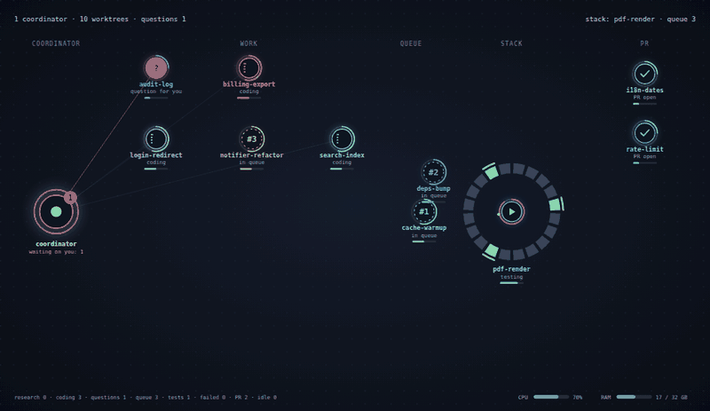

# agent-stage-cc

A live, animated stage for multi-agent work in Claude Code. It sits beside the
chat and shows every agent working in a git worktree of your repository: what
each one is doing, who is waiting on you, who holds a shared resource such as
a local stack of containers, and what all of it costs your machine.



It is a Claude Code mod (a plugin of function hooks). It reads what agents do
and never asks them to report anything, it enforces nothing, and it needs no
configuration to start.

## What you get

- **A pane beside the chat** with the scene: a coordinator, the agents at
  work, a queue, the shared resource, and open pull requests. Agents keep a
  fixed place and glide between zones. The layout follows the pane's shape.
- **A row above the prompt** with bare figures in fixed colors: CPU and
  memory, each as the stage's own share and then the whole machine, what is
  left of your Claude rate limits, questions and failed tests. Hover a figure
  for its name.
- **The same in the status line**, with short names.
- **Notifications** when an agent asks you something, its tests fail, or the
  shared resource is released.

## Install

At the prompt of a terminal session:

```
/plugin install agent-stage-cc --marketplace Davv7d/agent-stage-cc
```

From a shell:

```bash
claude plugin install agent-stage-cc --marketplace Davv7d/agent-stage-cc
```

In the desktop app, where `/plugin` does not run: click **+** next to the
prompt box, then **Plugins**, **Add marketplace** with
`Davv7d/agent-stage-cc`, then **Add plugin**.

Sessions that were already running pick the mod up when they are restarted.

## Try it

```
/stage demo
```

opens the pane with an invented team that walks through every state, so you
can see the whole scene without any agents of your own. `/stage live` returns
to real data.

## How it works

Each session that has the mod records what its agent is doing in a small file
shared by every worktree of the repository, and every session draws the stage
from those files. One agent is one worktree; its name and its color follow the
worktree folder's name.

| State | When |
| --- | --- |
| `idle` | Nothing is running |
| `research` | Reading and searching: `Read`, `Grep`, `Glob`, web tools, read-only shell commands |
| `coding` | Editing files, or any other shell command |
| `testing` | A shell command that runs tests |
| `failed` | That command failed |
| `question` | The agent asked a question, or ended its turn on one |
| `queue` | The agent waits for the shared resource |
| `pr` | `gh pr create` answered with a pull request's address |
| `done` | The pull request merged; the agent then leaves the stage |

Pink always means a question for you, red an error, amber something worth a
look. A session becomes the **coordinator** the first time it hands work to
another session.

The state names are a stable contract: skins and other tools may rely on them.

## Commands

| Command | What it does |
| --- | --- |
| `/stage` | Open the pane |
| `/stage demo`, `/stage live` | Invented team, or real data |
| `/stage band` | Hide or show the row above the prompt |
| `/stage status` | The stage as text |
| `/stage grant <agent>` | Give the shared resource to an agent |
| `/stage release` | Free it |
| `/stage queue <agent>`, `/stage unqueue <agent>` | Add to or remove from the waiting line |
| `/stage order <agent> <agent> ...` | Put the waiting line in this order |
| `/stage scope <container> ...` | Say which containers are in scope |

`<agent>` is a worktree name or a distinctive part of one.

## A shared resource

Some things only one agent should use at a time: a local stack of containers,
a staging database, a device. The mod records who holds such a resource and
who waits, and draws it as a ring with the holder inside and the queue beside
it. It **only records and shows**: who gets the resource is your decision, or
your coordinator's, and nothing is blocked or restored for you.

The model has the same actions as a tool, `resource`, and every session is
told in a short section of its instructions how to keep the record with it: a
coordinator grants, queues and releases, the holder reports its scope. That
section teaches the tool and sets no policy; `"guide": false` in your config
leaves it out.
Once the holder names the containers it will touch, the ring has one segment
per container, a swapped image shows in the holder's color (told by comparing
with the image each container ran when it came into scope), and a rim marks a
container under load.

Without a resource the scene simply has no ring.

## Configuration

Everything is optional.

**Yours**, in `~/.config/agent-stage-cc/config.json`:

```json
{
  "band": true,
  "guide": true,
  "notify": { "question": true, "failed": true, "released": true, "pr": false },
  "refreshSeconds": 3,
  "asleepAfterMinutes": 30
}
```

**A project's**, in `.agent-stage-cc.json` at the root of the repository:

```json
{
  "testCommands": ["\\./scripts/run-checks\\.sh\\b"],
  "coordinatorTools": ["^delegate_task$"]
}
```

Both lists are regular expressions. `testCommands` replaces the built-in
recognition of common test runners; `coordinatorTools` names the tools that
hand work to another agent. Nothing about any particular project lives in the
mod itself.

The scene's language follows your system locale (English, Polish).

## Where the state lives

In `<git common dir>/agent-stage-cc/`, which every worktree of a repository
shares and git never commits: one file per agent in `agents/`, one per shared
resource in `resources/`, and the latest usage measurement. Files of worktrees
that no longer exist are removed. Outside a git repository the mod does
nothing.

CPU and memory are shown twice. The whole machine is what the system itself
counts: `/proc/stat` and `/proc/meminfo` on Linux, `ps` and `vm_stat` on
macOS. The stage's own share is the sum of the processes whose working
directory lies in an agent's worktree, plus `docker stats` for the containers
in scope. Only one session measures at a time and the others read its result.

## Status

Early, and built against an early-access plugin API that may change.

- Developed and used on the Claude Code desktop app on Linux.
- The macOS probe for CPU and memory is written and unit-tested but has not
  run on a Mac yet.
- In the desktop app a notification is a toast inside the coordinator's
  session, not a system notification.
- One skin, Neon. More skins, and skins from your own sprite sheets, are
  planned; the scene already draws agents through a small skin interface.
- The scene shows one shared resource; the data model holds several.

## Development

```bash
claude plugin validate .
claude plugin test .
```

To run the mod from a checkout, name the folder in `CLAUDE_CODE_PLUGIN_DIRS`
(in the `env` block of `~/.claude/settings.json`), or start a terminal session
with `claude --plugin-dir <folder>`. The engine lays its type declarations in
`.claude-plugin/types/` when it loads the mod; `tsconfig.json` extends them.

The original design mockup is in [`docs/design`](docs/design/scene-mockup.html).

## License

MIT
